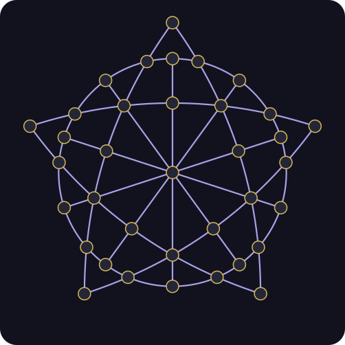

# AI Games: Pentalfa Cruzado Circulado

A standalone C11/GTK 4/libadwaita puzzle for the 36-point board suggested by the
user's teacher. Human, Random, Heuristic, Search, and Ollama controllers discover
placements at runtime. No solution sequence or database is supplied.

The target stays 35 for experiments. The new graph controllers prove that the
implemented topology permits at most 34 pieces; see the graph analysis below.

## How to play

Start with all **36 points empty**. Introduce **35 pieces**, one at a time:

1. Enter an empty point.
2. Pass over exactly the next point on the same path. It may be empty or occupied.
3. Stop at the following empty point. Only this destination becomes occupied.

Existing pieces never move or disappear. Follow three consecutive points on one
path, in either direction. Do not turn onto another path at an intersection or
skip points. The circle is a **closed path**, so it continues through `r0` in
both directions; the other paths end at their endpoints.

Placing 35 pieces wins. An attempt is stuck when fewer pieces are placed and
there are no legal placements. The goal and closed-circle rule were agreed with
the user for this implementation of the supplied board.

Click an empty entry point and then a highlighted destination. Escape clears the
selection. Undo removes the last human placement. Begin starts the configured
controller; Restart clears the board; New configuration returns to setup.

## Board and paths



Labels run clockwise: `v0`–`v4` are the five external tips, `r0`–`r19` the twenty
circle points, and `i0`–`i9` the ten inner points. Each group begins at its top
point. `c` is the center. Labels are displayed in the application.

| Path | Consecutive points |
| --- | --- |
| p1 | v0, r1, i1, i2, i3, r7, v2 |
| p2 | v1, r5, i3, i4, i5, r11, v3 |
| p3 | v2, r9, i5, i6, i7, r15, v4 |
| p4 | v3, r13, i7, i8, i9, r19, v0 |
| p5 | v4, r17, i9, i0, i1, r3, v1 |
| p6 | r0, i0, c, i5, r10 |
| p7 | r2, i1, c, i6, r12 |
| p8 | r4, i2, c, i7, r14 |
| p9 | r6, i3, c, i8, r16 |
| p10 | r8, i4, c, i9, r18 |
| p11 | r0 through r19, closing back to r0 |

The five star curves provide 50 directed placements, the five central lines 30,
and the circle 40: **120 distinct movements** before occupancy filtering. In
particular, `r19 → r0 → r1` and its reverse are legal on an empty board.

The engine uses 64-bit occupancy and explicit movement lists, including movement
IDs above 63. A single generator creates topology, coordinates, original SVG
artwork, icon, and directed movement geometry. It constructs five rotationally
symmetric quadratic star curves, their intersections with five central diameters,
and a circle of radius 0.76 relative to the external vertex radius. Animation
uses arc-length sampling of those same paths, including wrapped circular arcs.

## Algorithms and limits

- **Random:** uniformly samples a legal placement.
- **Heuristic:** simulates each candidate and maximizes
  `256 × pieces after placement + legal movements remaining`. Since each candidate
  places one piece, this favors immediate mobility. Equal scores are randomized.
- **Search:** maximizing depth-limited search, with iterative deepening from 1 to
  the selected depth (1–35, default **3**). Leaves use the same piece-count and
  mobility score; terminal positions have no mobility bonus. The weight 256 keeps
  an extra piece more valuable than any mobility bonus. Equivalent destinations
  share a child evaluation. A bounded sparse transposition table uses five
  rotations and five reflections, plus remaining depth. It never allocates a
  dense table for all `2^36` occupancy masks.
- **Ollama:** receives the rules, all eleven ordered paths, current board, and
  legal placements. Pure mode is the default. Optional search assistance supplies
  only the best candidates from the last completed depth. The prompt explicitly
  states its depth and that it does **not guarantee victory**. Every returned
  entry/destination pair is validated locally; the engine derives its unique
  intermediate point and path.

Each search decision defaults to **60 seconds and 256 MiB**. Limits are editable
in configuration or after a failed decision. Zero seconds removes the time limit;
memory remains bounded. Accounted memory covers search allocation and conservative
stack/static symmetry allowances, not total application RSS.

When a limit interrupts a deeper iteration, Search and assisted Ollama use the
**last fully completed iteration**. Partially evaluated root candidates never
replace its results. The status shows requested/completed depth and the resource
limit. If no depth completes, play stops; adjust limits/depth and Retry without
clearing the board. Cancellation discards results. High depths can be expensive;
full-depth completion is not promised. Allocation failures stop visibly rather
than silently switching algorithms.

Ollama supports the established native/Cogito thinking policies. Model discovery
has a 1000-second timeout and a turn 18000 seconds; assistance also obeys its
separate search budget. Configure `OLLAMA_URL` to change the default localhost
server. Search progress shows completed depth, visited nodes, elapsed time, and
accounted memory. The interface supports English, Portuguese, Spanish, and Italian.

## Animation and lifecycle

Each newly introduced piece blinks at the entry for half the configured delay,
then follows the selected curve, central line, or circular arc for the other half.
The destination is committed only on arrival. Delay zero commits immediately;
changing delay affects subsequent placements. Pause freezes animation and keeps
completed pending decisions until resumed. Restart and configuration cancel stale
search, HTTP, and animation work. Human Undo is disabled during a placement.

## Build and validation

Dependencies match the other applications: Meson, C11, GLib, GTK 4, libadwaita,
libsoup 3, and JSON-GLib. From the repository root:

```sh
make GAME=pentalpha-crossed-circle
make GAME=pentalpha-crossed-circle run
make GAME=pentalpha-crossed-circle test
make GAME=pentalpha-crossed-circle test-ollama
xvfb-run -a dbus-run-session -- make GAME=pentalpha-crossed-circle test-ui
python3 scripts/generate-pentalpha-crossed-circle-board.py --check
python3 scripts/test-pentalpha-crossed-circle-runner.py
```

Engine tests build without graphical development libraries. Tests verify all
movements, symmetries, geometry, independent search evaluations, limits,
cancellation, mock Ollama protocols, and UI lifecycle. The screenshot helper
captures actual widgets. Install with `make GAME=pentalpha-crossed-circle install`;
the desktop ID is `io.github.aigames.PentalphaCrossedCircle`.

## CSV experiments and logs

```sh
pentalpha-crossed-circle/build/puzzle-runner --controller=search --depth=3 --runs=10 --seed=0 --time-limit=60 --memory-limit=256
```

Available runner controllers are `random`, `heuristic`, and `search`. CSV includes
seed, controller, requested depth, limits, board result, pieces placed, sequence,
nodes, elapsed microseconds, minimum/last completed depth, last search status,
number of limited decisions, and peak accounted search bytes. Sequences use
`entry>middle>destination@pN`. Search may finish blocked; shallow evaluation is
not a proof of a winning continuation. Resource-limited experiments may make
wall-clock-dependent choices; deterministic tests use budgets that complete.

Histories append to `pentalpha-crossed-circle-history.md` in the working directory,
including candidate scores, actual depths, limits, search statistics, and paths.
Full model exchanges use `pentalpha-crossed-circle-ollama.log`; failures also use
`pentalpha-crossed-circle-ollama-error.log`. See [logging](../docs/logging.md).
`make run` launches inside this game's directory.

## Artwork and license

The supplied reference is titled “Pentalfa Cruzado Circulado”, with the name
“Academia da Realidade Fractal”. It was used to identify the board topology.
The photograph, background, QR code, and branding are not redistributed. The
project includes original geometric SVG artwork and generated C data.
Code and generated artwork are GPL-3.0-or-later; see [COPYING](COPYING).

### Pause at the end

Configuration includes **Pause at the end (solved or blocked)**, off by default.
When enabled, the final placement finishes and the attempt is recorded before a
modal acknowledgement pauses play. Select **Continue** or close the dialog to
review the unchanged final board; use Restart, New configuration, or Human Undo
to proceed. With the option off, the existing final-board behavior is unchanged.
The setting applies to all controllers and is retained when restarting within
the current session.

## Simple two-color proof that 35 pieces are impossible

Color the board points as follows:

- **Blue:** the center `c` and the ten even-numbered circle points
  (`r0`, `r2`, …, `r18`): **11 points**.
- **Red:** all remaining points: **25 points**.

Every legal placement has an **entry and destination of the same color**:

- All points on the five star curves are red.
- Each central line alternates blue, red, blue, red, blue.
- The circle alternates blue and red, including across its closing boundary.

A placement follows three consecutive points on one path, so its two endpoints
always have the same color. Both endpoints must be empty before the placement;
only the destination becomes occupied.

Now consider filling the **last empty blue point**. This would require another
empty blue point as the entry, but none would remain. Therefore the last empty
blue point cannot be filled. The same argument applies to red points.

Starting from the empty board, at least **one empty point of each color** must
remain. Hence:

```text
occupied points ≤ 36 − 1 blue empty point − 1 red empty point = 34
```

Thus **35 pieces are impossible under the implemented rules and topology**.
This proves the upper bound; the runtime spanning-forest construction described
below also achieves 34, proving that the bound is optimal.

## Additional graph and algebra controllers

**The configured target remains 35, but 34 is the proven maximum under the
implemented rules and topology.** A 34-piece attempt is still recorded as
`stuck`, with a separate **Proven optimum reached** diagnostic for the new
controllers. Existing Random, Heuristic, Search, and Ollama algorithms and their
assistance are unchanged. Human remains the default controller.

The relevant graph connects an entry point to its destination, not to its
intermediate point. The intermediate occupancy does not affect legality. The
120 directed placements give 60 undirected edges. There are two components:

- 11 vertices: `c` and the ten even-numbered circle points.
- 25 vertices: all five external tips, ten inner points, and ten odd-numbered
  circle points.

View a placement as deleting its destination from the graph of empty points.
Each connected component must retain at least one empty vertex, since filling
its last vertex would require another empty entry in that same component. A
spanning tree in each component supplies a constructive matching bound: remove
children before their parents, leaving the root empty. Consequently:

```text
maximum final pieces = pieces already placed
                     + empty points − empty components
                     = 36 − empty components
```

This applies to the current board, including boards fragmented by earlier
choices. From the empty opening the maximum is `36 − 2 = 34`. No increase in
search depth, RAM, or time can reach 35 without changing the rules or topology.
The product retains that target as an experiment, rather than redefining victory.

Four additional configuration choices are available:

| Controller | Method |
| --- | --- |
| Connectivity | Evaluate each legal destination by the exact maximum final-piece count of the resulting empty-point graph. Randomize among equally good placements using the decision seed. |
| Spanning Forest | Construct a seeded spanning forest at runtime and play a complete optimal continuation, filling descendants before ancestors. |
| Gauss–Jordan GF(2) | Build an incidence matrix, perform Gauss–Jordan row elimination modulo two, retain independent original edge columns, and turn the resulting forest into an optimal placement plan. |
| Search — sibling symmetry pruning | A separate iterative-search variation that merges symmetry-equivalent child occupancies before recursively evaluating them, including at the root. Preserve the values and complete best-move set of the legacy Search at each completed level. |

The GF(2) matrix initially has **36 rows and 60 columns**, with two 1s per edge
column; its rank is **34**. Occupied vertices and incident edges are excluded on
later boards. Pivot columns select original legal graph edges; transformed
matrix columns are not interpreted as game moves. The matrix is an **incidence
matrix**, rather than a 36×36 adjacency matrix or a matrix of actual occupancy
changes (a placement occupies only its destination).

The three graph controllers use bounded, small fixed-size storage and do not
need a depth limit. They support cancellation. Forest plans are generated once
per planning position, revalidated one placement at a time, and discarded on
Restart or New configuration. Pause and end-of-attempt acknowledgement work as
for the original controllers. Rank is displayed only when elimination actually
ran, and denotes the board where that forest was planned.

The symmetry-search variation retains its own configurable depth/time/memory
limits and complete-iteration fallback. Its sibling-prune counter is separate
from transposition-cache hits. The legacy Search already canonicalizes cached
positions under the five rotations and five reflections; sibling pruning avoids
additional repeated calls, including calls at the uncached horizon. Graph
analysis is diagnostic for this variation and does not alter its evaluation.

The UI and histories distinguish the initial proven maximum from the current
maximum after fragmentation. They never label a 34-piece board as a solved
35-piece puzzle. Optimal plans and proofs are computed at runtime, with no
stored solution sequence.

### Compare the new choices

```sh
pentalpha-crossed-circle/build/puzzle-runner --controller=connectivity --runs=10 --seed=0
pentalpha-crossed-circle/build/puzzle-runner --controller=spanning-forest --runs=10 --seed=0
pentalpha-crossed-circle/build/puzzle-runner --controller=gf2-forest --runs=10 --seed=0
pentalpha-crossed-circle/build/puzzle-runner --controller=search-symmetry --depth=3 --memory-limit=256
```

Existing CSV columns are retained. Added columns are `proven_max_initial`,
`empty_components` (final/current board), `matrix_rank_initial`, `proof_status`,
`optimum_reached`, `sibling_prunes`, `cache_hits`, and `gf2_xor_operations`.
Uncomputed numeric graph/rank fields use `-1`; proof status is `not-computed` for
legacy controllers and `proven` for successful new graph analysis. Search status
remains `not-used` for non-search controllers. An initial GF(2) rank of 34 is
kept separately from the component count at the end of playback. Legacy seeded
choices and evaluations are protected by regression digests captured before the
variations were added; these digests contain no playable solution sequence.
